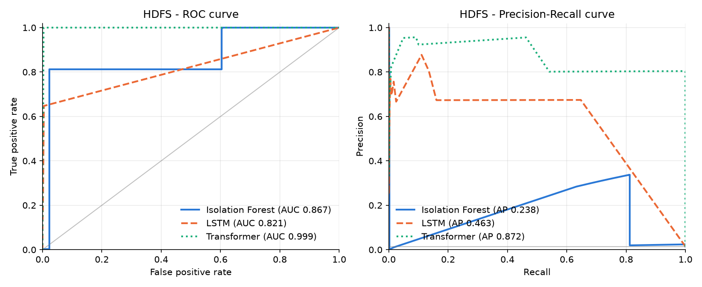
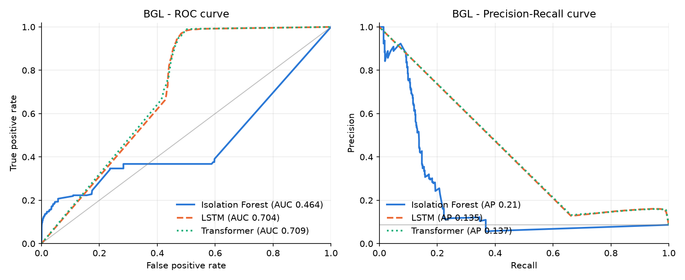
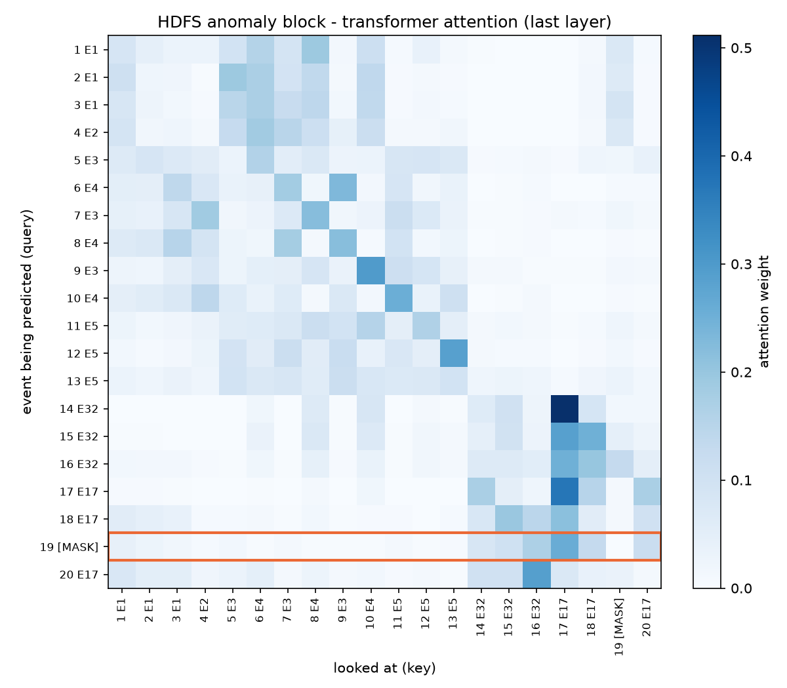

# Log Anomaly Detection with LLM Explanations

Comparing Isolation Forest, LSTM and Transformer models for finding anomalies in system logs (HDFS and BGL), and explaining the flagged HDFS blocks with a local LLM.

## Quick look

All my results are already saved in the `results/` folder, so you can see everything without downloading the data:

```
pip install -r requirements.txt
python run_all.py
```

This prints the model results, the speed test and the LLM rating results, and lists the figures to open. It takes a few seconds.

To run the whole project again from the raw logs, download the data first (see Data below) and then run:

```
python run_all.py full
```

This runs every step from parsing to the plots, and then shows the same results. It takes long on a laptop CPU. The LLM example runs only if Ollama is running, otherwise it is skipped.

## What is in this project

I parse raw logs into event templates with Drain and compare 3 models: Isolation Forest, an LSTM (DeepLog idea) and a small Transformer (masked event prediction, like LogBERT). I use 2 datasets from Loghub, HDFS and BGL.

The data is split by time, not random. Oldest 70% is for training, next 10% for validation and newest 20% for test. Models are trained only on normal logs and labels are used only for validation and testing. Settings like top k and threshold are picked on validation, so the test set is used only one time at the end. Every model is run with 3 seeds.

I also made ROC and precision-recall curves, a speed test and one attention example for the transformer.

For the HDFS blocks flagged by the transformer, a local LLM (llama3.2 3B with Ollama, so logs stay on my laptop) writes a short explanation for a support engineer. I compare the answers with and without RAG, where RAG adds notes from a small runbook I wrote.

## Data

Both datasets are from Loghub (https://github.com/logpai/loghub). Download HDFS_v1.zip and BGL.zip from https://zenodo.org/records/8196385 and unzip them into `data/hdfs/` and `data/bgl/`. The data folder is not uploaded because it is too big.

HDFS is grouped by block id. BGL has no block id, so I cut it into windows of 100 lines, and a window is anomaly if any line inside is an alert.

## How to run each step

I used Python 3.13. Run everything from the main project folder. `run_all.py full` runs these in order, but each one can also be run alone.

```
python src/01_parse_hdfs_logs.py
python src/02_split_hdfs_data.py
python src/03_parse_bgl_logs.py
python src/04_split_bgl_data.py

python src/05_train_isolation_forest.py hdfs
python src/05_train_isolation_forest.py bgl
python src/06_train_lstm.py hdfs
python src/06_train_lstm.py bgl
python src/07_train_transformer.py hdfs
python src/07_train_transformer.py bgl

python src/08_plot_curves.py
python src/09_speed_test.py
python src/10_attention_heatmap.py
```

To train isolation forest on all training data (without labels), add `all` after the dataset name, for example `python src/05_train_isolation_forest.py hdfs all`.

For the LLM part, install Ollama (https://ollama.com) and download the model first:

```
ollama pull llama3.2:3b

python src/11_llm_explain.py
python src/12_llm_rating_sheet.py
python src/13_rate_answers.py
python src/14_compare_rag.py
```

11 explains one example block without and with RAG. 12 explains 30 flagged blocks and makes the rating sheet, where the two answers are A and B in random order. 13 is for rating them by hand in the terminal, and 14 opens the key and compares the scores. Running 12 again makes new answers and a new empty sheet, so my rated sheet would be replaced.

Results and figures go to `results/` and trained models to `models/`. The two scripts in `analysis/` are the checks I used to find why some results were bad.

## Model settings

Drain uses similarity 0.5 and depth 4, and block ids, IPs, hex values and numbers are masked before parsing.

Isolation Forest has 100 trees. I tried event counts, binary and ratio features, with threshold at 1, 5 or 10% of the train scores.

The LSTM looks at the last 10 events and predicts the next one (embedding 32, LSTM 64 with 2 layers, 5 epochs).

The Transformer works on chunks of 20 events. During training 15% of events are hidden and it guesses them from both sides (embedding 64, 4 heads, 2 layers, 10 epochs).

LSTM and Transformer train on 20000 normal blocks for HDFS and 5000 normal windows for BGL. A sequence is anomaly if the real event is not in the top k guesses at least m times. I tried k = 5, 9, 15 and m = 1, 2, 5, 10, and picked them on validation.

For the LLM, temperature is 0 and the answer is JSON with summary, likely cause, severity and next step. The runbook has 14 short notes about HDFS block events, and the 3 most similar notes (TF-IDF) are put before the logs.

## Results

Test set, setting picked on validation, mean of 3 seeds (std in brackets):

| Model | HDFS F1 | HDFS AUC | BGL F1 | BGL AUC |
|---|---|---|---|---|
| Isolation Forest | 0.477 (0.000) | 0.868 | 0.198 (0.007) | 0.460 |
| LSTM | 0.635 (0.032) | 0.812 | 0.269 (0.004) | 0.706 |
| Transformer | 0.811 (0.130) | 0.923 | 0.273 (0.000) | 0.706 |

The transformer had one bad seed on HDFS. If I keep the seed with the best validation F1 (seed 42), test F1 is 0.891 and AUC 0.999.




## Speed

Measured on my laptop CPU. "ms" is the time to check one sequence alone and "per sec" is how many sequences it checks in one second in batch.

| Model | HDFS ms | HDFS per sec | BGL ms | BGL per sec |
|---|---|---|---|---|
| Isolation Forest | 4.67 | 77,651 | 5.41 | 24,424 |
| LSTM | 0.72 | 3,417 | 2.32 | 473 |
| Transformer | 3.18 | 354 | 15.39 | 40 |

All of them are fast enough for real time, the slowest is about 15 ms. The transformer is around 10x slower than LSTM in batch because at test time it hides each event one by one. So LSTM is a good balance, and transformer gives the best accuracy but costs more.

## Attention example



This is an HDFS anomaly block with 20 events. The first 18 are the normal life of a block: it is received, stored on 3 machines and then deleted. At position 19 the real event is "Unexpected error trying to delete block, BlockInfo not found". The transformer guessed "Deleting block" there, which is the normal next step, and it looked most at positions 17, 16 and 18, the delete messages around it. So it learned the normal delete pattern from both sides and flagged the error. Attention shows where the model looked, it does not fully explain why it decided.

## LLM explanations

I rated 30 blocks flagged by the transformer (24 real anomalies and 6 false alarms), so 60 answers. Each field got 0 (wrong), 1 (partly) or 2 (correct), so one answer is out of 8. I did not know which answer was RAG while rating.

| | Summary | Cause | Severity | Next step | Total |
|---|---|---|---|---|---|
| Without RAG | 0.90 | 0.47 | 0.40 | 0.67 | 2.43 |
| With RAG | 0.70 | 0.70 | 0.53 | 0.97 | 2.90 |

RAG was better on 15 blocks, worse on 9 and the same on 6. On real anomalies RAG got 3.58 and no RAG 2.58, but on normal blocks RAG got only 0.17 and no RAG 1.83. Without RAG the model said severity "high" for 26 of 30 blocks, with RAG it was mostly "medium".

## What I found

On HDFS, isolation forest with raw counts was almost useless (F1 0.014). Test blocks are shorter than train blocks (15.4 vs 20.5 events), so I changed to ratio features and it went up to 0.477.

The transformer is clearly best on HDFS, I think because it uses events from both sides while LSTM only looks back. But it is less stable. One of 3 seeds was much worse (F1 0.660 vs around 0.89), and that seed had the lowest training loss, so low loss does not mean a good detector. Validation ranked the seeds in the same order as test, so a bad model can be caught before using it.

On BGL all models are weak and almost the same. 47% of the normal test windows have event types that never came in training, so the models mark them as anomaly and a better model does not help. A random split would have hidden this. Validation F1 on BGL is also much higher than test (around 0.70 vs 0.27), because validation comes right after training in time and test is further away, so it has more new events.

Picking settings on test makes results look better than real. My first BGL isolation forest number was 0.222, with validation it is 0.198.

The LLM explains well when the logs have a clear error message, like a socket timeout or connection reset. When the problem is small or there is no problem, it often makes up a failure. RAG gives better causes and next steps on real anomalies, but on normal blocks it is worse, because the runbook notes are about failures. The prompt also says our model found an anomaly, so the LLM almost never says a block looks fine.

## Limitations

Only 3 seeds, and the transformer std on HDFS is big, so more seeds would be better. BGL gives 1127 templates and some may be the same message split into different templates. The HDFS test period has many short normal blocks, probably blocks that were not finished when the log ended, which I still need to check. Speed is from one laptop, so it will be different on other machines. The LLM rating has only 30 blocks (6 normal) and one rater (me), and it is not fully blind because RAG answers sometimes use words from the runbook. Pandas is fixed to 2.2.3 because newer versions were blocked by Windows Smart App Control on my laptop.

## References

Xu et al., Detecting large-scale system problems by mining console logs, SOSP 2009.
Du et al., DeepLog, CCS 2017.
Guo et al., LogBERT, IJCNN 2021.
Le and Zhang, Log-based anomaly detection with deep learning: how far are we?, ICSE 2022.
He et al., Drain, ICWS 2017.
Zhu et al., Loghub, ISSRE 2023.
Lewis et al., Retrieval-augmented generation for knowledge-intensive NLP tasks, NeurIPS 2020.